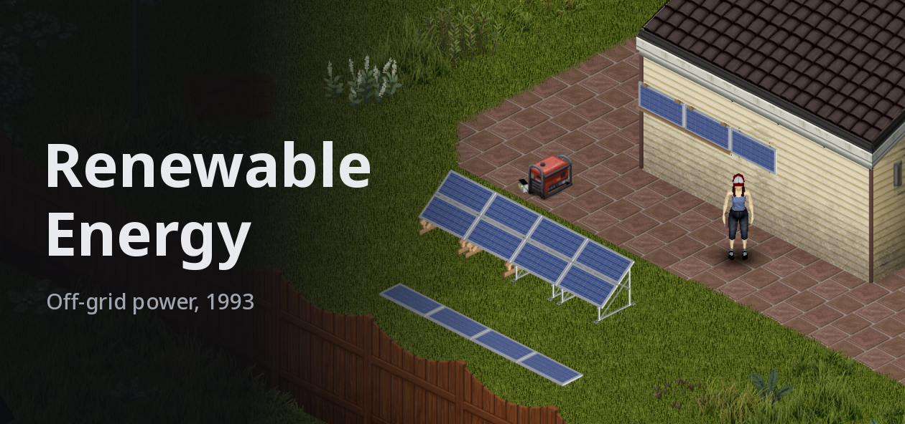
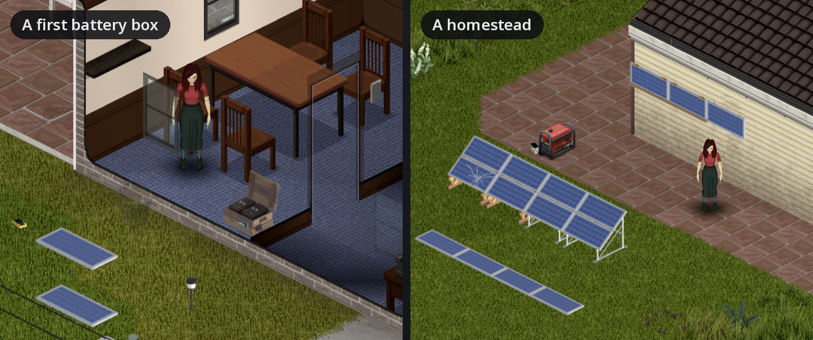
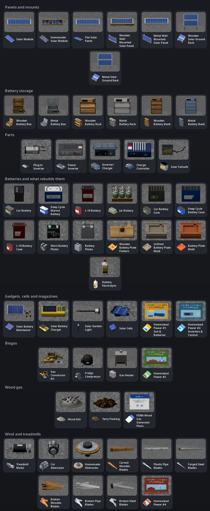
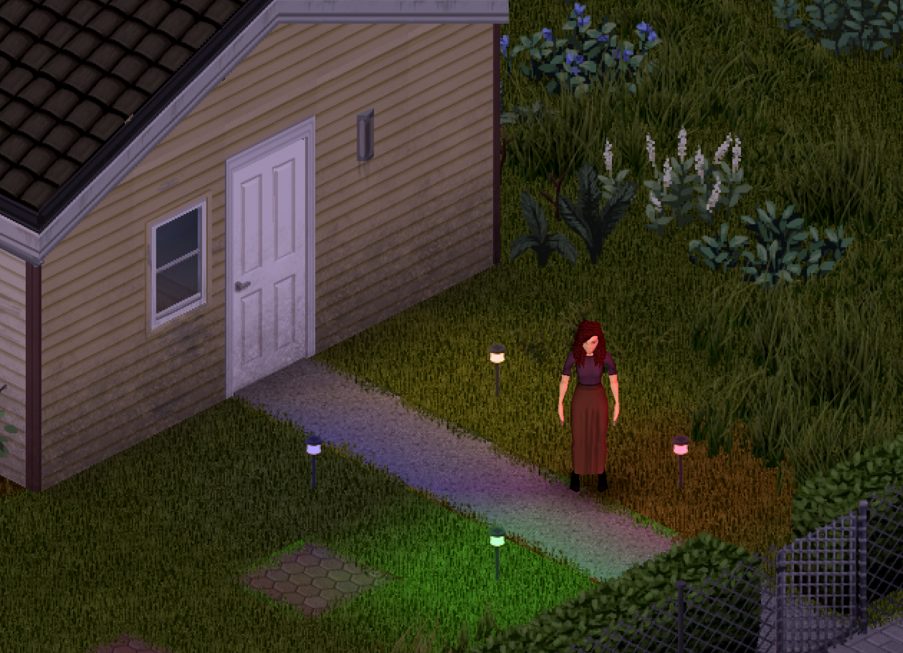
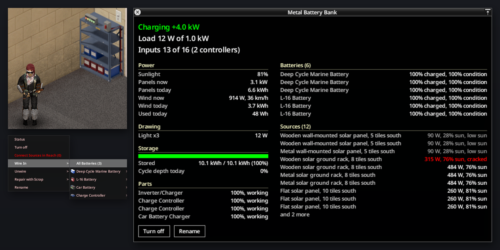
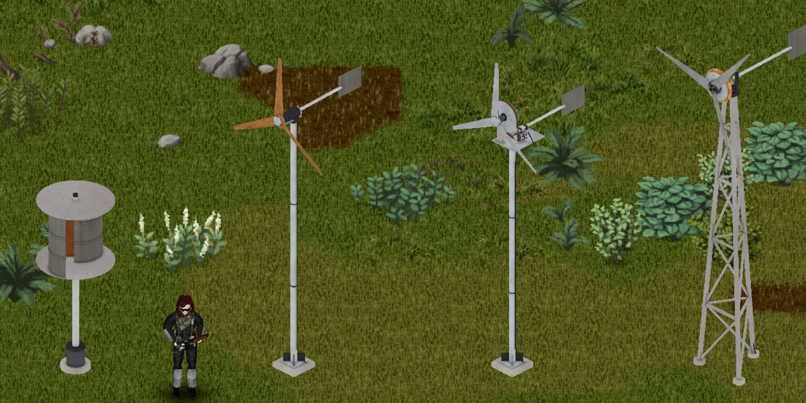
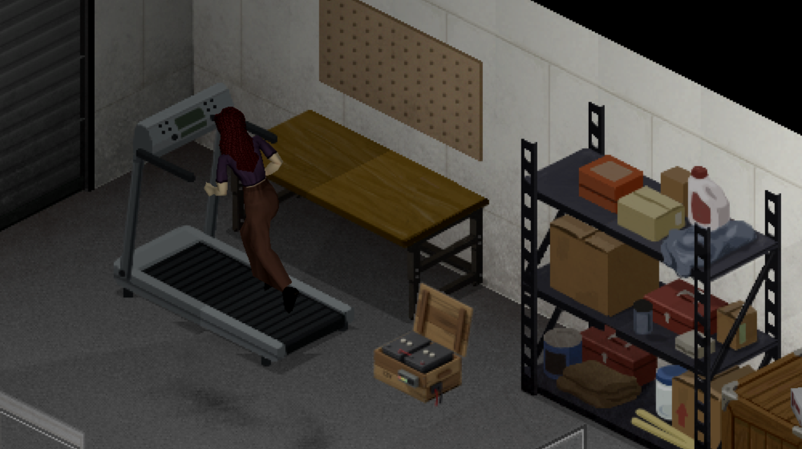
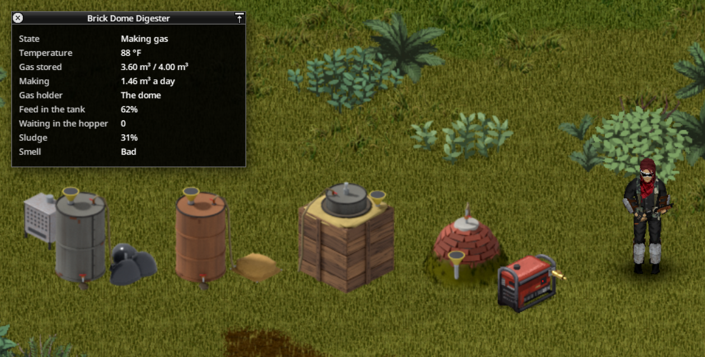
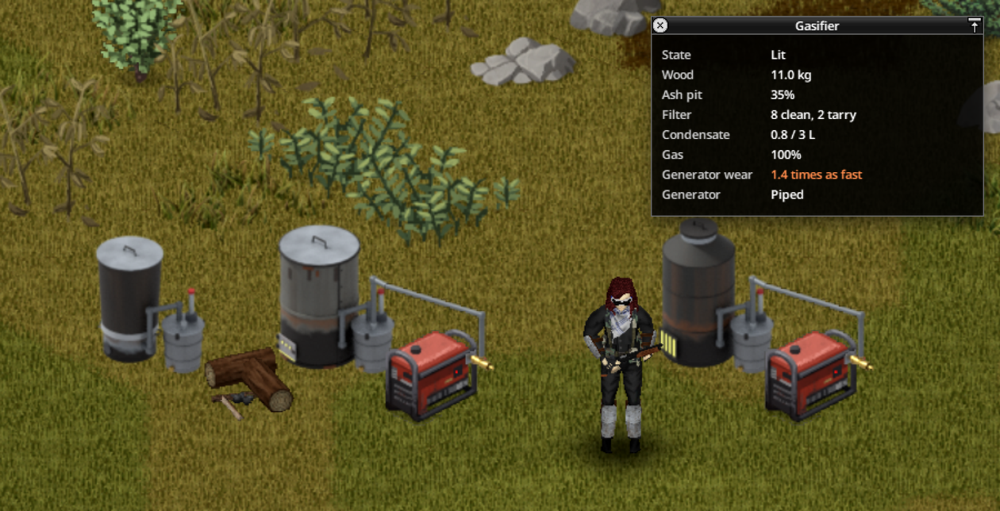
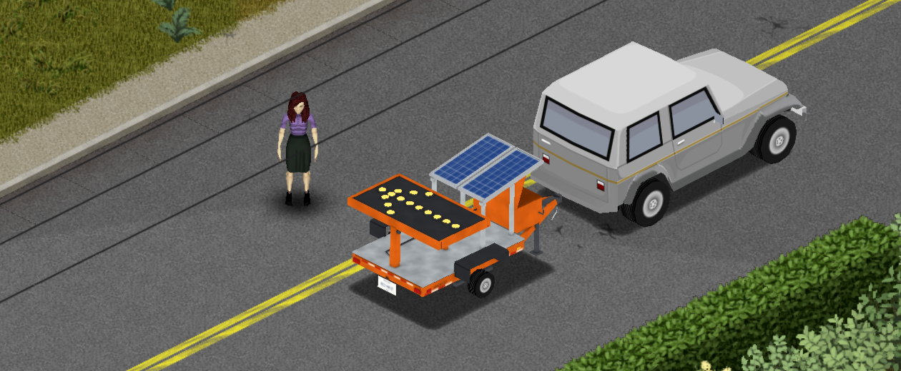

# 

*Work in progress: still being balanced and updated. Feedback is welcome in the comments.*

Keep the lights on after the grid and the gas are gone, with what a Kentucky farm, cabin or RV owner could have had in 1993: solar panels, wind chargers, a treadmill, a bank of batteries, and a generator that runs on manure gas or wood. You start with a car battery in a wooden box, enough for the TV and a lamp. Every panel after that is one you found, fixed or built, every battery wears out, and the weather decides what you get.

**Build 42.20 or newer.** Single player and multiplayer. Fine to add to a save in progress.

## How it plays

| When | What you're after | What it takes |
|---|---|---|
| The first weeks | The TV and the lights, and a mini fridge while the sun's up | A battery box, two car batteries, a plug-in inverter, two panels or a treadmill |
| A month or so in | The kitchen fridge through the night | A battery rack of deep cycles, a bigger inverter, a charge controller, a handful of panels, a scoop rotor |
| Months later | The freezer, the washer, and a backup that needs no gasoline | A bank of L-16s, an inverter/charger, two controllers, a propeller wind charger, a generator with a failsafe on digester or wood gas |
| The long haul | The whole house, all winter | A metal bank, two inverter/chargers, four controllers, every panel you can find, homemade wind chargers on the high ground, a brick dome digester |

## Everything you can find or build

- **Banks** hold the batteries and what you wire into them: inverters, charge controllers, a charger and a **Solar Failsafe** that starts the generator when they run low.
- **Batteries wear** with every deep drain. Service and recondition them, each repair bringing them back less far, then strip and rebuild them with plates you cast yourself.
- **Panels follow the sun**: flat ones for summer, wall panels for winter, ground racks for the year. Storms crack modules; seal them with epoxy or reglaze them.
- **Wind chargers, treadmills, digesters and gasifiers** fill in when the sun won't.
- **Small gadgets** need no bank: a maintainer for a parked car's battery, a charger for flashlight batteries, and garden lights.

## Getting started

1. Craft a battery box and **Place Object** indoors.
2. Right-click it and **Wire In** batteries and an inverter.
3. **Connect Bank**, like a generator: Electricity 3, or the generator magazine.
4. Put up a panel outside, then **Connect Sources in Reach**.
5. **Turn On**. **Status** shows what it's doing, and why each source isn't at full output.

The bank powers everything a generator in its spot would, the neighbours' lights included, so set up away from town. Switch on more than the inverters carry and the power cuts out until you switch something off.

## Wind

Build them on the **Welding** page. A scoop rotor turns in any breeze and never breaks; a propeller makes real power, but **Set the Brake** before a gale or you'll be replacing blades; a homemade alternator on a two-storey mast turns itself out of the wind. Trees and buildings steal wind; upper floors give more.

## Treadmills

No sun, no wind? **Wire to a Bank** and **Run on Treadmill**: half an hour banks about what a fridge-freezer draws in that time, at the cost of endurance. Taken apart, it gives up the motor wind chargers are built around.

## Biogas

Feed a digester manure and scraps, keep it above 10 °C, and it makes gas. Overfeed it and it sours until you add wood ash or baking soda; indoors, it can poison the house, and it stinks. **Install Gas Conversion Kit** on a generator, **Connect Gas Line** with a rubber hose for every five squares, and **Run on Gas**: its tank stays as it was. A tire pump or a fridge compressor bottles the gas for propane tanks.

## Wood gas

FEMA's 1989 plans run an engine on wood: a gasifier from a trash can, a steel drum or welded sheet metal, right beside a kitted generator. Fill it with wood or charcoal and light it, clean out the ash, change the filter packing before the tar gets through, and keep it outdoors.

## Crafting

Learn recipes from the Homestead Power magazines and FEMA's plans, by levelling the skills they use, or by researching a part you found. Most need a table and enough light; battery rebuilds need a furnace, a hand press and a kiln. Inverters, the maintainer and the battery charger can't be crafted. Every recipe is on [one sheet](art/promo/images/recipes.png).

## Where to look

Think about who had this stuff in 1993: campers and boaters, farmers, electricians, the phone and power companies, road crews and preppers. Cracked modules are common, good ones aren't. Some places come already set up, their panels usually up on the roof where the sun is, so bring what it takes to build your own way up. Now and then a barn or a hunting shack has something out back, never in working order.

The easiest start is on the road. Road crews, army checkpoints and traffic jams left solar arrow boards behind, still flashing, with batteries in the box and panels on top:

## Sandbox options

- **Sunlight Multiplier**: how much power panels make.
- **Loot Rarity Multiplier**, for modules, batteries and the rest.
- **Battery Wear** and **Storm Damage**: 0 and off for an easier game.

The rest are on the **Renewable Energy** page.

## Questions

- **Can I add it to my save?** Yes. Loot turns up where you haven't been yet; solar sites and garden lights anywhere.
- **Can I remove it?** Not cleanly: what it built into your world goes with it.
- **How does it all work, and where do I look?** The [player's guide](docs/player-guide.md) explains every mechanic and hints where the gear is.

## Credits

Inspired by [Immersive Solar Arrays](https://github.com/radx5Blue/ImmersiveSolarArrays) by RadX5 and Poltergeist.

## Install

Playtest builds come as `RenewableEnergy-<version>.zip`. Unzip it into your mods folder, so that you end up with `~/Zomboid/mods/RenewableEnergy` (on Windows, `C:\Users\<you>\Zomboid\mods\RenewableEnergy`), and enable **Renewable Energy** in the mod list. Keep only one copy installed, since two copies conflict.

## Development

Clone this repository to `~/Zomboid/Workshop/RenewableEnergy`. [DEVELOPMENT.md](DEVELOPMENT.md) has the commands for testing the mod and rebuilding the art, plus notes on the Build 42 behavior it relies on. [AGENTS.md](AGENTS.md) has the rules. Rebuilding the art needs [Blender](https://www.blender.org/) and [uv](https://docs.astral.sh/uv/).
