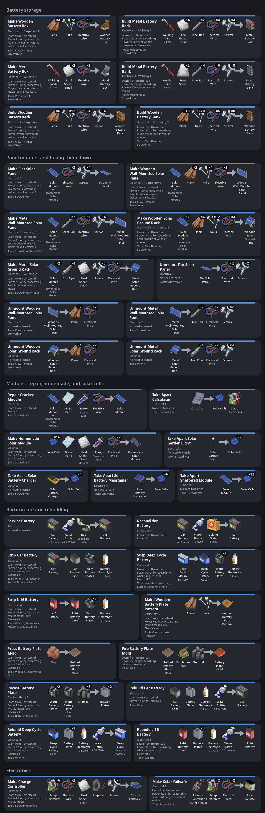

# 

Sooner or later the grid goes down, and sooner or later the gas runs out too. A generator buys you time, but it's loud, it fills the house with fumes if you run it inside, and it eats scrap electronics to keep going.

Renewable Energy is the other option: the solar gear a Kentucky household, farm or RV owner could have owned in 1993. None of it comes easy. You start with a car battery in a wooden box and an inverter that plugs into a lighter socket, enough for the TV and a lamp. Every panel is one you found, fixed or built, every battery wears out, and the weather decides what you get. Keep at it, and a few months later there's a room full of L-16s, a yard of panels, and a generator you only start when it's been cloudy all week.

Requires Build 42.20 or newer. I've tested it in single player on 42.21.0, and its in-game tests also pass in multiplayer, on a dedicated server with a client joined.

## Install

Playtest builds come as `RenewableEnergy-<version>.zip`. Unzip it into your mods folder, so that you end up with `~/Zomboid/mods/RenewableEnergy` (on Windows, `C:\Users\<you>\Zomboid\mods\RenewableEnergy`), and enable **Renewable Energy** in the mod list. To work on the mod instead, clone this repository to `~/Zomboid/Workshop/RenewableEnergy`. Keep only one copy installed, since two copies conflict.

## How it works

**sun → panels → battery bank → inverters → the appliances around you**

Panels go outdoors and charge a battery bank indoors: a box, rack or bank of batteries with an inverter wired in. Switched on, it powers everything a generator in its spot would, as long as the batteries hold a charge and everything switched on adds up to less than the inverters carry. While the grid is up, the bank stands by.

A generator is the backup. The bank's chargers fill the batteries from it, or from the grid while it lasts, and a Solar Failsafe starts and stops it for you.

## How it plays

You'll go through roughly these stages:

| When | What you're after | What it takes |
|---|---|---|
| Before the grid goes | Stocking up | Car batteries filled on a Car Battery Charger, or a battery box filling from the grid |
| The first weeks | The TV, a lamp, a mini fridge | A battery box, two car batteries, a Plug-in Inverter, two panels, and a couple of hours of generator on grey days |
| Weeks 3 to 6 | The kitchen fridge | A battery rack of deep cycle batteries, a Power Inverter, a charge controller and 5 to 7 modules |
| Months 2 and 3 | Fridge and freezer all year, the washer, the microwave | A battery bank of L-16s, an Inverter/Charger, two charge controllers, a failsafe on the generator, and 16 or more modules, most on ground racks |
| After that | The electric range and the dryer | A metal bank with two Inverter/Chargers, four charge controllers and 20 to 30 panels |

Panels are what you'll spend the game chasing: you find a few, fix the cracked ones, and eventually build your own out of whatever has solar cells in it.

## How real is it?

Real where that's fun, gamey where it isn't.

The sun moves the way it does over Knox County, worked out from the in-game date and time and checked against sunlight measured at Louisville from 1961 to 1990. You start in July, when that's easy. By December a flat panel makes less than a third of its July output, clouds, fog and rain cut it further, and snow piles up on flat panels until you sweep it off. The hardware is what they sold then: 50 W modules, marine and L-16 batteries, inverters for RVs and cabins.

Some of it isn't realistic, on purpose:

- Out of the box, panels make two and a half times what they would have. Set **Sunlight Multiplier** to 1 for true 1993 output, when it took a yard full of panels to run one fridge.
- An inverter is just a number of watts: go over it and the bank shuts off. No startup surge, no voltages.
- Sixteen calculators make a solar module, about a thousand times what their cells really give. It's meant to be a chore, so you'll go looking for garden lights instead.
- You can melt a worn battery's plates down at a furnace and cast new ones. Battery recyclers really do that, just not in somebody's backyard.

Wall objects hang on the north and west edges of a square, so a wall panel can only face south or east. Those are the walls you'd pick anyway.

## Getting started

A first battery box by a window, and a homestead with panels on the wall and in the yard:

1. **Build a bank.** Battery boxes, racks and banks are furniture: craft one, right-click it in your main inventory and **Place Object**. It has to go indoors.
2. **Wire in the parts.** Right-click the bank and **Wire In** each battery, inverter, charge controller and car battery charger. That takes a wrench or screwdriver, some Electrical Wire and enough light to see. **Unwire** gives the part and wire back.
3. **Mount the panels.** A Solar Module is a loose panel. Craft it into a flat or wall panel, or put two on a ground rack, and place it outside.
4. **Connect them.** Right-click the bank and **Connect Panels in Reach**, or right-click a panel and pick a bank. Panels have to be within 20 tiles and 3 floors of the bank.
5. **Turn it on.**

## Battery banks

Everything you do to a bank is in its right-click menu, and **Wire In** tells you why a part can't go in yet. **Status** shows what the bank is doing, down to why each panel isn't at full sun, and clicking a panel's row lights it up in the world.

Every size comes in wood, which takes carpentry, or metal, which takes welding and holds more batteries:

| | Batteries | Inverters | Chargers | Charge controllers | Panels |
|---|---|---|---|---|---|
| Battery Box | 2 | 1 | 1 | none | 2 |
| Battery Rack | 6 wood, 8 metal | 1 | 2 | 2 | up to 16 |
| Battery Bank | 12 wood, 16 metal | 2 | 2 | 4 | up to 30 |

Two panels need no charge controller, and each working controller makes room for seven more. The chargers are vanilla's Car Battery Chargers, each putting in 250 W whenever grid power or a running generator reaches it. That's how you get through a grey week: run the generator for a couple of hours, shut it off, live on the batteries.

### Inverters and what things draw

| Inverter | Carries | Wiring in needs |
|---|---|---|
| Plug-in Inverter | 150 W | Any skill |
| Power Inverter | 600 W | Electrical 2 |
| Inverter/Charger | 2,500 W, and charges the bank at 1,500 W from the grid or a generator | Electrical 4 |

Two inverters carry their ratings added together. Go over that and the power cuts out until you switch enough off, and flat batteries cut it until the panels put a little back. About a tenth is lost as heat.

The reach is a generator's, neighbours' houses included, and in town most of them still have lights on and a fridge plugged in. Switch those off or smash them, or set up away from other houses.

Each appliance draws a fixed amount while it runs:

| Appliance | Watts while running |
|---|---|
| Fridge-freezer | 200, about 40% of the time |
| Fridge or freezer | 160, about 40% of the time |
| Mini fridge | 80, half the time |
| Light | 60 |
| TV | 65 |
| Radio | 10 |
| Car battery charger | 100 |
| Washer | 500 |
| Microwave | 1,000 |
| Electric range | 2,000 |
| Dryer | 4,000 |

The inverter has to carry the running watts, but the batteries only pay while the compressor is on. So a Plug-in Inverter runs the TV and a lamp, or a mini fridge, but not the kitchen fridge. Anything else draws in proportion to the fuel a generator would burn for it.

### Batteries

| Battery | Holds |
|---|---|
| Car battery (vanilla) | 600 Wh |
| Deep Cycle Marine Battery | 1,260 Wh |
| L-16 Battery | 2,100 Wh |

The batteries in a bank share one charge, and each day's drain wears them with the square of its depth: twice as deep wears four times as fast. A deep cycle battery kept above half lasts years, while a car battery run down halfway every day is done within months. The deep cycle battery also fits a car. The L-16 won't: it's 6 volts and weighs as much as a big dog.

### Keeping it running

Three repairs bring a worn battery back. **Service Battery**, with water and a rag or baking soda, gives back some condition. **Recondition Battery**, with more of both, gives back a lot but leaves it flat. A **rebuild** makes it like new, and it's a project: strip the battery and save its acid, recast the worn plates at a furnace in a clay mold you fired yourself, and put it back together. Only charcoal and water get used up, so a battery you look after lasts as long as you play. Spill the acid and you'll need Battery Electrolyte.

Inverters and charge controllers wear while they run, and an inverter more each time you overload it. Fix them with **Repair with Scrap** in the bank's menu, the way you'd fix a generator. Worn out, they stop until you do.

A vanilla generator plugged in within 3 tiles of the bank, on the same floor, is its backup: while it runs it carries the load and the bank's chargers fill the batteries. With a **Solar Failsafe** on its square, the bank starts it when the batteries run low and stops it once they're mostly full. It still needs fuel.

## Panels

What a panel makes depends on the sun, the season and the weather, and each mount suits a different season:

| Mount | Modules | Snow | Goes |
|---|---|---|---|
| Solar Ground Rack | 2, tilted | Slides off after a little sun or a thaw | Ground or flat roof, any direction. It blocks the square. |
| Flat Solar Panel | 1 | Stays until it melts, or you **Clear Snow** with a broom or shovel | On a roof or the ground |
| Wall-Mounted Solar Panel | 1, upright | Never | On an outside wall |

On a clear day at the default sunlight, one module makes:

| Module on | Noon, July | Whole day, July | Whole day, December |
|---|---|---|---|
| A ground rack, facing south | 90 W | 0.7 kWh | 0.5 kWh |
| A flat panel | 95 W | 0.8 kWh | 0.25 kWh |
| A south wall | 40 W | 0.27 kWh | 0.55 kWh |

For scale, a fridge-freezer uses about 2 kWh a day, and a cloudy day makes a fraction of that table. Racks make the most over a year, flat panels are best in summer, and wall panels in winter.

Thunderstorms with strong wind crack modules now and then: never on walls, less on metal mounts, most on wooden ones. A cracked module makes power in proportion to its condition and shows its broken glass from across the yard. **Repair Cracked Module** patches it with glass, epoxy or glue, and wire, but never back to new.

Calculators, garden lights, the solar gadgets and shattered modules all come apart for solar cells. Sixteen cells, a glass pane, a frame, glue and wire make a **Homemade Solar Module**. It never gets better than 60%, so 30 W, but mounts and repairs like any other.

## Small solar gadgets

Three gadgets work without a bank:

- **Solar Battery Maintainer**: right-click a car parked outdoors and **Attach Solar Maintainer**, and it trickle-charges the battery in daylight. Before you've got a bank, that makes the car radio and headlights your first radio and lamp.
- **Solar Battery Charger**: set it outdoors with up to 4 flashlight batteries in it, and a sunny day or two charges them.
- **Solar Garden Light**: a little light on a stake that charges by day and glows for a few hours after dark.

Some houses have a row of garden lights along the front walk, more often in nice neighbourhoods than in trailer parks:

Each garden light holds one light bulb. A plain bulb glows warm yellow, and any of vanilla's coloured bulbs lights it in that colour. Right-click a placed light for **Remove Light Bulb**, or **Add Light Bulb** to put in one you carry. Without a bulb it still charges, but never lights. Every light you find, in a store or along a front walk, has a plain bulb, which stays in when you pick the light up and comes back out when you take it apart.

## Items

Every item in the mod as it lies on the ground, with its inventory icon:

## Crafting

Every recipe's inputs, result, skills and how you learn it, drawn from the game's own recipe data:

Most recipes need a table or counter and enough light, and the plate and mold steps need a furnace, a hand press and a kiln. Unmounting, taking things apart and servicing a battery need no learning. You learn the rest from the two Homestead Power magazines, by levelling Electrical, or by researching a part you found: a Plug-in Inverter teaches the battery boxes, an Inverter/Charger the banks and the failsafe. The inverters, the maintainer and the solar battery charger can't be crafted.

## Where to look

Think about who had this stuff in 1993: people with campers and boats, farmers, electricians, the phone and power companies, road crews, and preppers.

| Item | Best places |
|---|---|
| Homestead Power #1 | Electronics store magazine racks, bookstores, hardware and camping stores, survivor caches, now and then a living room shelf |
| Homestead Power #2 | Electrician vans, electronics store racks, phone and power company vans, generator rooms, survivor caches |
| Plug-in Inverter | Gas station emergency shelves, auto parts and electronics stores, campers, garages, now and then a glove box |
| Solar Battery Maintainer | Auto parts stores, campers, farm stores, mechanics, fishermen's and farmers' trucks |
| Solar Battery Charger | Camping stores, electronics stores, survivor safehouses |
| Solar Garden Light | Garden centers, hardware stores, garages and barns, and some houses' front walks |
| Solar Module | Solar kits, survivor caches, campers, utility and electrician vans. Cracked ones are much more common: garages, sheds, junkyard cars, farm storage. |
| Power Inverter | Camper trailers, auto parts stores, electrician vans, solar kits |
| Charge Controller | Solar kits, power and phone company vans, electrician vans, camper trailers |
| Deep Cycle Marine Battery | Auto parts stores, camper trailers, solar kits, electronics store back rooms and warehouses, battery plants |
| Inverter/Charger | Rare: phone company vans, survivor caches, control rooms, generator rooms |
| L-16 Battery | Rare: electronics store back rooms and warehouses, phone and power company vans, battery plants |
| Battery Electrolyte | Auto parts stores, mechanics, battery plants |
| Solar Failsafe | Hardly ever found. Craft it. |

A solar kit is the stock of an RV or cabin setup: modules, deep cycle batteries, charge controllers, now and then an inverter or a magazine. Some store back rooms, warehouses, storage units, garages and safehouses hold one instead of their usual loot. Some rooms hold a stocked bank the first time anyone sees them: a battery box in a shed, garage or storage unit, a rack of mostly deep cycles in farm storage, or a metal rack of deep cycles or L-16s in an electronics store's back room. Loot respawn never refills a bank, a battery charger or a solar crate.

### Solar sites

Some places come already set up, though not every site is there in every world. Their banks are switched off and their panels not yet connected:

| Site | Where | What's there |
|---|---|---|
| Stock tank pumps | Seven pastures around Rosewood, Muldraugh, West Point, Valley Station and Brandenburg | A ground rack beside the trough |
| Farmhouses | South of Riverside, east of Rosewood, a barn west of West Point | Flat panels on the roof, a battery box inside, garden lights out front |
| Campers | Scenic Grove, Dixie and Bright Valley trailer parks, a cabin at Camp Fitzgerald | Flat panels on the roof, a battery box with a deep cycle battery |
| Relay sheds | The phone company's radio masts around Brandenburg, Irvington and Riverside | Ground racks and a rack of L-16s with an Inverter/Charger |
| Deer Valley Power yard | The substation west of Muldraugh, the best haul on the map | Ground racks, a bank of L-16s with an Inverter/Charger, and a crate of modules |
| Ranger stations | Deerhead Lake and Doe Valley | Wall panels or racks, a battery box with deep cycle batteries |
| Road works | North of Muldraugh, east of Riverside, in Rosewood | A solar arrow board |

Solar arrow boards are the orange trailers road crews park at work zones, with a flashing arrow and two panels on top:

They also turn up in junkyards, highway pileups and with tradesmen's vans. The battery box on the tongue holds deep cycle batteries and a charge controller, and one module is often cracked. Strip it where it stands, or tow it home, where its panels keep charging its batteries. Storms and crashes crack the panels and crashes dent the frame; right-click the trailer to repair either.

### Stash houses

The **Stash Houses** sandbox option adds four houses stocked with a crate of solar gear: a trapped prepper's farmhouse on Crowcall Road south of Rosewood, a solar mobile home in the Dixie trailer park, a barn on Soretoe Road in Rosewood, and Dale's Electric in West Point. Depending on the option, they're stocked from the start, or once you read the map that leads there: survivalists and bandits carry Crowcall Road's, any body Dixie's, and Rosewood and West Point town maps lead to the other two.

## Sandbox options

All of these are on the **Renewable Energy** page, the ones you're most likely to change first:

- **Sunlight Multiplier**: how much power panels make. 1 is what panels really made in 1993. Lower it for a harder game where every panel counts, raise it if you'd rather not spend the game chasing panels.
- **Loot Rarity Multiplier**, one each for solar modules, batteries and everything else: how often the mod's items turn up as loot. 0 takes them out. The game's own loot sliders apply on top.
- **Battery Wear**: how hard deep draining wears batteries. 0 turns wear off, if you'd rather not keep replacing and rebuilding them.
- **Battery Bank Spawn**: how often rooms come with a stocked bank or a crate of solar gear.
- **Solar Sites**: the chance each of the map's solar sites is there in a new world.
- **Stash Houses**: whether to add the stash houses, and whether maps lead to them or they're stocked from the start. Set it before you start a new game.
- **Storm Damage** and **Storm Damage Rate**: whether thunderstorms crack modules, and how often.
- **Garden Lights**: how often houses have garden lights. 0 turns them off.
- **Failsafe Start Charge** and **Failsafe Stop Charge**: the charge at which a failsafe starts and stops the generator. Start it earlier to spare the batteries deep drains, at the cost of fuel.
- **Connect Panel Time**: how long connecting a panel takes.
- **Charge Frequency**: whether banks work out their charge every ten minutes or every hour. Hourly costs a busy server less, and the charge comes out about the same.

## Development

[DEVELOPMENT.md](DEVELOPMENT.md) has the commands for testing the mod and rebuilding the art, plus notes on the Build 42 behavior it relies on. [AGENTS.md](AGENTS.md) has the rules. Rebuilding the art needs [Blender](https://www.blender.org/) and [uv](https://docs.astral.sh/uv/).

## Credits

By Caleb Fenton. Inspired by [Immersive Solar Arrays](https://github.com/radx5Blue/ImmersiveSolarArrays) by RadX5 and Poltergeist. Licensed under the Apache License 2.0, see [LICENSE](LICENSE).
