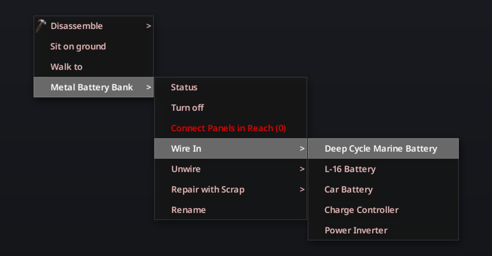
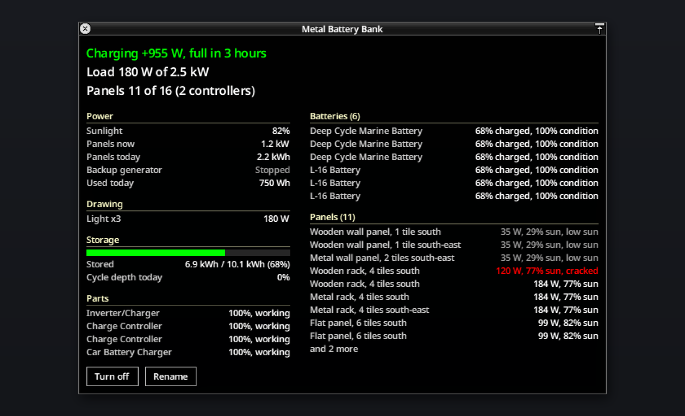
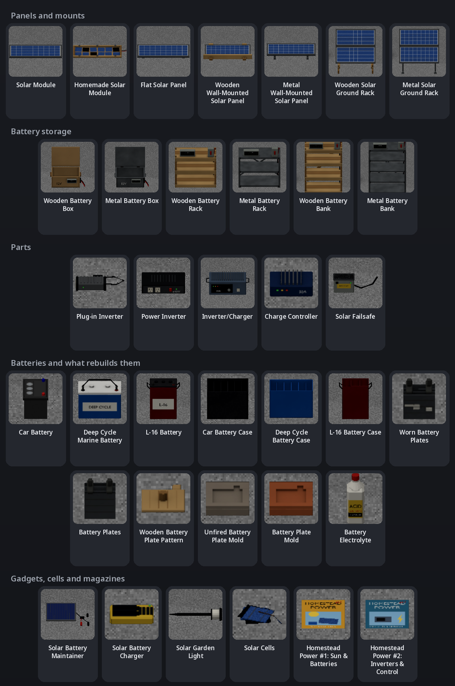

# 

Sooner or later the grid goes down, and sooner or later the gas runs out too. The pumps in Knox County hold what they hold and nobody's coming to refill them. A generator buys you time, but it's loud, it fills the house with fumes if you run it inside, and it eats scrap electronics to keep going.

Renewable Energy is the other option: the solar gear a Kentucky household, farm or RV owner could have owned in 1993. You start with a car battery in a wooden box and an inverter that plugs into a lighter socket, which is enough for the TV, your tapes and a lamp. A few months later there's a room full of L-16s, a yard of panels, and a generator you only start when it's been cloudy all week.

Requires Build 42.20 or newer. I've tested it in single player on 42.21.0. It loads on a dedicated server, and the server owns the banks, but nobody has played it with clients connected yet.

## Install

Playtest builds come as a zip file, `RenewableEnergy-<version>.zip`, with one `RenewableEnergy` folder in it. Unzip it into your mods folder, so that you end up with `~/Zomboid/mods/RenewableEnergy` (on Windows, `C:\Users\<you>\Zomboid\mods\RenewableEnergy`). Start the game and enable **Renewable Energy** in the mod list.

To work on the mod instead, clone this repository to `~/Zomboid/Workshop/RenewableEnergy` and start the game with Steam running. Keep only one copy installed, since two copies of the same mod conflict.

## How it works

Power runs one way through the mod:

**sun → panels → battery bank → inverters → the appliances around you**

Panels go outdoors and charge the batteries in a battery bank indoors. A bank is a box, rack or bank of batteries with an inverter wired in. Switched on, it powers everything a generator standing in its spot would power, 20 tiles around and 3 floors up and down, for as long as there's charge in the batteries and everything switched on adds up to less than the inverters carry. While the grid is still up, the bank stands by and lets the grid do the work.

A generator is the backup. Car battery chargers wired into the bank, and the charger built into an Inverter/Charger, fill the batteries from any running generator that reaches the bank, or from the grid while it lasts. A generator plugged in within 3 tiles of the bank carries the house while it runs, and a Solar Failsafe under it starts and stops it for you when the batteries run low.

## How it plays

You'll go through roughly these stages:

| When | What you're after | What it takes |
|---|---|---|
| Before the grid goes | Stocking up | Car batteries filled on a Car Battery Charger, or a battery box with the charger wired in, filling from the grid |
| The first weeks | The TV, a lamp, a mini fridge | A battery box, two car batteries and a Plug-in Inverter, plus a panel or two or a couple of hours of generator a day |
| Weeks 3 to 6 | The kitchen fridge | A battery rack of deep cycle batteries, a Power Inverter, a charge controller and 4 to 6 panels |
| Months 2 and 3 | Fridge and freezer all year, the washer, the microwave | A battery bank, L-16s, an Inverter/Charger, two charge controllers, a failsafe on the generator, 10 to 14 panels |
| After that | The electric range and the dryer | A metal bank with two Inverter/Chargers, four charge controllers and 20 to 30 panels |

Panels are what you'll spend the game chasing. You find a few, you fix the cracked ones, and eventually you build your own out of whatever has solar cells in it.

## How real is it?

Real where that's fun, gamey where it isn't.

The sun moves the way it does over Knox County. The mod works out its height and direction from the in-game date and time at 38° north, and I checked the output against sunlight measured at Louisville between 1961 and 1990. You start in July, when that's easy. By December a flat panel makes less than a third of what it did in July. Overcast lets through about a quarter of the light, and fog and rain take more. Snow piles up on flat panels until it melts or you go out with a broom.

The hardware is the stuff they really sold then: 50 W modules, marine and L-16 batteries, inverters for RVs and cabins. Batteries wear out faster the harder you drain them, and a car battery hates it most because it was built to start an engine.

Some of it isn't realistic, on purpose:

- Panels make three times what they would have. Set **Sunlight Multiplier** to 1 for true 1993 output, when it took a yard full of panels to run one fridge.
- An inverter is just a number of watts. Put more on it than that and the bank shuts off until you switch something off. Real fridges kick hard when they start, and real systems care about voltage. This one doesn't.
- Cold doesn't hurt batteries. They live indoors anyway.
- The solar charger recharges flashlight batteries. In 1993 most of those were throwaway alkalines, but the game only has one kind.
- Sixteen calculators make a solar panel. A real calculator cell is about a thousandth of what this gives you credit for. It's meant to be a chore, so you'll go looking for garden lights instead.
- You can melt a worn battery's plates down at a furnace and cast new ones. Battery recyclers really do that, just not in somebody's backyard.

One thing fell out of the game by accident. Project Zomboid hangs wall objects on the north and west edges of a square, so a panel on an outside wall can only face south or east. Those are the walls you'd pick anyway.

## Getting started

Here's a first battery box by a window, and a finished homestead with its bank indoors and panels on the wall and in the yard:

1. **Build a bank.** Battery boxes, racks and banks are furniture. Craft one, then place it like a chair: item in your main inventory, right-click, **Place Object**. It has to go indoors.
2. **Wire in the parts.** Right-click the bank and use **Wire In** for each battery, inverter, charge controller and car battery charger. Batteries take a wrench and the rest a screwdriver, each one uses up some Electrical Wire, and you need enough light to see what you're doing. **Unwire** gives you the part and the wire back. You can't just drag parts in or out.
3. **Mount the panels.** A Solar Module is a loose panel. Craft it into a flat panel or a wall panel, or put two on a ground rack, and place it outside.
4. **Connect them.** Right-click the bank and pick **Connect Panels in Reach**, or right-click a panel and pick a bank. Panels have to be within 20 tiles and 3 floors of the bank.
5. **Turn it on.** From then on the bank powers everything a generator in its spot would.

Everything you do to a bank is in its right-click menu: **Status**, **Turn on** or **Turn off**, **Connect Panels in Reach**, **Wire In**, **Unwire**, **Repair with Scrap** and **Rename**. **Wire In** lists each kind of part you're carrying, and greys out the ones you can't wire in yet with the reason, such as a missing tool, skill or wire:

Before you've got a bank, a **Solar Battery Maintainer** helps. Right-click a car parked outdoors and pick **Attach Solar Maintainer**, and it keeps the battery topped up in daylight, so the car radio and headlights become your first radio and lamp.

## Battery banks

The bank's status window shows everything the bank is doing:

Every size comes in wood or metal. Wood takes more carpentry than metal takes welding, since planks are easy to come by, so a good carpenter can build any of them. Metal holds a couple more batteries. Each size holds this much:

| | Wood needs | Metal needs | Batteries | Inverters | Chargers | Charge controllers | Panels |
|---|---|---|---|---|---|---|---|
| Battery Box | Electrical 1, Carpentry 1 | Electrical 1, Welding 1 | 2 | 1 | 1 | none | 2 |
| Battery Rack | Electrical 3, Carpentry 4 | Electrical 3, Welding 2 | 6 wood, 8 metal | 1 | 2 | 2 | up to 16 |
| Battery Bank | Electrical 4, Carpentry 7 | Electrical 4, Welding 4 | 12 wood, 16 metal | 2 | 2 | 4 | up to 30 |

Charge controllers decide how many panels a bank takes. Two panels are fine on their own, and each working controller makes room for seven more. Wiring one in takes Electrical 3 and a Scrap Electronics on top of the wire.

The chargers are vanilla's Car Battery Chargers. Wired into a bank, each one puts in 250 W whenever grid power or a running generator reaches it, and the generator burns fuel for that. That's how you get through a grey week: run the generator for a couple of hours, shut it off, live on the batteries.

Right-click the bank and choose **Status** to see whether it's charging or draining and how long until it's full or empty, the load against what the inverters can carry, what's drawing it, how many panel slots are used, and every part and battery with its condition. Each panel gets a row with its watts, how close it is to full sun, and why it isn't: night, cloud, snow, a low winter sun, a crack, or no controller slot for it. Click a row and that panel lights up in the world. If you've got more than one bank, rename them. Right-clicking a panel tells you which bank it's connected to.

### Inverters

An inverter decides how much the bank can run at once:

| Inverter | Carries | Draws while on | Wiring in needs |
|---|---|---|---|
| Plug-in Inverter | 150 W | 4 W | Any skill |
| Power Inverter | 600 W | 8 W | Electrical 2 |
| Inverter/Charger | 2,500 W, and charges the bank at 1,500 W from the grid or a generator | 15 W | Electrical 4 |

A bank with two inverters can carry both ratings added together. If everything switched on in its reach adds up to more than that, the power cuts out and the status window shows what's drawing what. It comes back by itself once you've switched enough off. The same goes for flat batteries: the bank cuts out when they're empty and comes back once the panels have put a little charge back. About 10% of what goes through an inverter is lost as heat.

The reach is a generator's: by default 20 tiles around the bank and 3 floors up and down, the neighbours' houses included. In town, most houses still have their lights switched on and a fridge plugged in, so a small bank there overloads before you've plugged anything in. Switch them off or smash them, or set up away from other houses.

### What things draw

Each kind of appliance draws a fixed amount while it runs:

| Appliance | Watts while running | Running |
|---|---|---|
| Fridge-freezer | 200 | about 40% of the time |
| Fridge or freezer | 160 | about 40% of the time |
| Mini fridge | 80 | half the time |
| Light | 60 | |
| TV | 65 | |
| Radio | 10 | |
| Microwave | 1,000 | |
| Washer | 500 | |
| Car battery charger | 100 | |
| Electric range | 2,000 | |
| Dryer | 4,000 | |

The inverter has to carry the running watts. The batteries only pay for the time the compressor is actually on. So a Plug-in Inverter runs the TV and a lamp, or a mini fridge, but not the kitchen fridge. Anything else that runs off a generator draws in proportion to the fuel vanilla would burn for it.

### Batteries

Three kinds of battery go in a bank:

| Battery | Capacity | Cycles at 50% a day | Weight |
|---|---|---|---|
| Car battery (vanilla) | 600 Wh | 80 | 5 |
| Deep Cycle Marine Battery | 1,260 Wh | 1,000 | 8 |
| L-16 Battery | 2,100 Wh | 1,200 | 16 |

The batteries in a bank share one charge. Every day the bank wears each of them by how deep it drained that day, and wear grows with the square of the depth, so draining twice as deep wears four times as fast: a deep cycle battery taken down 80% every day lasts about 400 days, at 50% about 1,000, at 25% about 4,000. Run a car battery down halfway every day and it's done in under three months. A car battery that stays in its car doesn't wear at all. Deep cycle and L-16 batteries you find hold 30 to 80% of a charge, and a battery's tooltip shows what it holds in watt-hours.

The deep cycle battery also fits a car. Open the mechanics window, right-click the empty battery slot and install it from **Install**. It holds about twice what a car battery does, so the radio and headlights run about twice as long with the engine off, and it takes twice as long to fill back up from the alternator. The L-16 won't go in a car. It's 6 volts and weighs as much as a big dog.

### Keeping batteries alive

Three repairs bring a worn battery back, each costing more and fixing more:

| Repair | Needs | Does |
|---|---|---|
| Service Battery | Electrical 1, half a litre of water, a rag or baking soda | +10 condition, up to 60%, and keeps the charge |
| Recondition Battery | Electrical 3, a litre of water, 2 baking soda | Back to 85%, but it comes out flat |
| Rebuild | Electrical 4 to strip and 5 to rebuild, Blacksmithing 3 for the plates, a furnace and a battery plate mold | Back to 100%, also flat |

Rebuilding takes three steps. Strip the battery with a wrench, a screwdriver and rubber, surgical or leather gloves, pouring its acid into empty containers that hold a litre each: one for a car battery, two for a deep cycle, three for an L-16. Melt the worn plates down at a furnace with 4 charcoal per set and cast new ones in a Battery Plate Mold. Then put the plates back in the case, pour the same acid back in and top it up with half a litre of water. Only the charcoal and the water get used up, so a battery you look after lasts as long as you play. Spill the acid and you'll need Battery Electrolyte, which auto parts stores sold by the litre.

The mold is made the way vanilla's ingot molds are. Cut a wooden pattern, press clay over it at a hand press and fire it in a kiln.

### Parts wear too

Inverters and charge controllers lose a little condition while they run, about a Scrap Electronics' worth a week for an inverter and half that for a controller, and an inverter loses more every time you overload it. Fix them with **Repair with Scrap** in the bank's menu, the way you'd fix a generator: Electrical 2, and each Scrap Electronics gives back 10 condition. At 0 they stop working until you do.

### Backup generator and failsafe

A vanilla generator plugged in within 3 tiles of the bank, on the same floor, is its backup. While it runs it carries the load and the batteries rest, and the bank's chargers fill them. Put a **Solar Failsafe** on the generator's square and the bank starts the generator when it drops below 20% and shuts it off at 80%. Both numbers are sandbox options. The generator still needs fuel, and it won't start at 20% condition or less.

## Panels

What a panel makes depends on the sun's height, the season, clouds, fog, rain and falling snow. The three mounts behave differently over the year:

| Mount | Modules | Year, compared to a rack | Snow | Goes |
|---|---|---|---|---|
| Solar Ground Rack | 2, tilted 38° | 100% | Slides off within a couple of hours of sun, or once it's above −2 °C | On the ground or a flat roof, facing any way. It blocks the square. |
| Flat Solar Panel | 1 | 90% | Stays until it melts. Right-click and **Clear Snow** with a broom or snow shovel. | On a roof or the ground |
| Wall-Mounted Solar Panel | 1, upright | 66% facing south, 57% east | Never | On an outside wall |

Flat panels are great in summer and bad in winter. Wall panels are the opposite: in December a south wall makes about twice what a flat panel does, and more again with snow on the ground bouncing light up at it. On a clear day at the default multiplier, one module makes:

| Module on | Noon, July | Whole day, July | Whole day, December |
|---|---|---|---|
| A ground rack, facing south | 110 W | 0.85 kWh | 0.6 kWh |
| A flat panel | 115 W | 1 kWh | 0.3 kWh |
| A south wall | 50 W | 0.3 kWh | 0.65 kWh |

For scale, a fridge-freezer uses about 1.9 kWh a day.

Wall panels and racks come in wood or metal, and both make the same power. The difference shows up in storms.

### Storms, cracks and repairs

A thunderstorm with a strong wind can crack a module, taking 30 points off its condition. Wall panels never crack, metal mounts hold up better than flat panels, and wooden mounts crack twice as often. At the default setting, ten flat panels get about one cracked module every two or three months. A module below 60% shows its cracked glass wherever it's mounted, so you can spot the ones that need fixing from across the yard.

A module makes power in proportion to its condition, so a cracked one at 40% makes 20 W. **Repair Cracked Module** (Electrical 3) takes a glass pane, epoxy or two glue, and a piece of wire, and gives back 30 points, up to 80%. You can make glass panes yourself once you've learned glassmaking.

### Building your own

Anything with solar cells in it can be taken apart for them:

| Take apart | Solar Cells |
|---|---|
| Calculator | 1, plus a Scrap Electronics |
| Solar Garden Light | 2 |
| Solar Battery Charger | 4 |
| Solar Battery Maintainer | 6 |
| A shattered module (0%) | 12 |

**Make Homemade Solar Module** (Electrical 4) takes 16 cells, a glass pane, a frame of 4 planks or a small steel sheet, epoxy or two glue, and 2 pieces of wire. It never gets better than 60%, so it makes 30 W, but it mounts and repairs like any other module.

## Small solar gadgets

Three gadgets work without a bank:

- **Solar Battery Maintainer**: clips onto a car parked outdoors and trickle-charges its battery in daylight. A sunny summer day puts back about a third of a car battery.
- **Solar Battery Charger**: place it outdoors and put up to 4 flashlight batteries in it. A sunny day or two charges a set.
- **Solar Garden Light**: a little light on a stake that charges by day and glows at night.

### Garden lights

Garden lights go on the ground outdoors. A sunny day fills one, and a full one glows for about six hours after dark. Some houses have a row of two to six of them along the front walk, like this:

About 2 houses in 5 have them in nice neighbourhoods, about 1 in 7 on ordinary streets and farms, and 1 in 25 in poor areas and trailer parks. Which houses have them is different every game. Pick them up and set them out at your own place, or take them apart for cells.

## Items

Every item in the mod, with its inventory icon:

And every item as it lies on the ground:

Here's what each one is for:

| Item | What it's for |
|---|---|
| Solar Module | A 50 W panel. Mount it flat or on a wall, or put two on a ground rack. |
| Homemade Solar Module | One you built from cells. Mounts like the real thing, tops out at 30 W. |
| Solar Cells | Taken out of calculators, garden lights and other solar gadgets, for homemade modules |
| Flat Solar Panel, Wall-Mounted Solar Panel, Solar Ground Rack | The mounts; walls and racks come in wood and metal |
| Battery Box, Battery Rack, Battery Bank | Where batteries and their parts go, each in wood and metal |
| Plug-in Inverter, Power Inverter, Inverter/Charger | See the inverter table |
| Charge Controller | Room for seven more panels on a bank |
| Solar Failsafe | Starts and stops the backup generator for you |
| Deep Cycle Marine Battery, L-16 Battery | See the battery table |
| Car Battery Case, Deep Cycle Battery Case, L-16 Battery Case, Worn Battery Plates, Battery Plates | What a stripped battery comes apart into, and the new plates that rebuild it |
| Wooden Battery Plate Pattern, Unfired Battery Plate Mold, Battery Plate Mold | The steps to the mold that battery plates are cast in |
| Battery Electrolyte | A litre of battery acid, for rebuilding a battery whose acid you lost |
| Solar Battery Maintainer | Clips onto a car and keeps its battery charged in daylight |
| Solar Battery Charger | Set it outdoors with 4 flashlight batteries in it, and they're charged in a sunny day or two |
| Solar Garden Light | A little light that charges by day and glows at night |
| Homestead Power #1: Sun & Batteries | Teaches the boxes, racks, mounts and module repair |
| Homestead Power #2: Inverters & Control | Teaches the banks, the charge controller, the failsafe, homemade modules, reconditioning and rebuilding |
| Crowcall Road Map, Dixie Trailer Park Map | Marked maps that lead to two of the stash houses |

Two vanilla items matter too: car batteries, which go in a bank, and the Car Battery Charger, which a bank wires in as its charger.

## Crafting

This chart shows every recipe's inputs and result, its skills and how you learn it:

Most recipes need a table or counter nearby, and all of them need enough light to see. Taking a gadget apart works in your hands, and the plate and mold steps happen at a furnace, a hand press and a kiln. Tools aren't used up.

Unmounting, taking things apart and servicing a battery don't need learning. Everything else you learn one of three ways:

- Read a Homestead Power magazine.
- Level up. Electrical 2 teaches the battery boxes, 3 the flat panel, 4 the battery racks and wall panels, 6 the whole battery rebuild.
- Research something you found. A Solar Module teaches the mounts, a Plug-in Inverter the battery boxes, a Power Inverter the racks, and an Inverter/Charger the banks and the failsafe. A Charge Controller teaches how to make one, and a deep cycle or L-16 battery how to rebuild it, though not the stripping and casting that come first. Researching needs about two thirds of the skill the recipe asks for.

The Solar Battery Maintainer, the Solar Battery Charger and the inverters can't be crafted. You have to find them.

Each table lists one group of recipes. In the **Learned from** column, #1 and #2 are the Homestead Power magazines.

### Battery boxes, racks and banks

| Recipe | Skills | Learned from | Uses up | Tools |
|---|---|---|---|---|
| Make Wooden Battery Box | Electrical 1, Carpentry 1 | #1, Electrical 2, researching a Plug-in Inverter | 4 Planks, 8 Nails, 2 Electrical Wire | Hammer, screwdriver |
| Make Metal Battery Box | Electrical 1, Welding 1 | #1, Electrical 2, researching a Plug-in Inverter | 2 small Steel Sheets, 2 Electrical Wire, 1 Welding Torch use | Welder mask, screwdriver |
| Build Wooden Battery Rack | Electrical 3, Carpentry 4 | #1, Electrical 4, researching a Power Inverter | 6 Planks, 12 Nails, 4 Electrical Wire, 4 Screws | Hammer, screwdriver |
| Build Metal Battery Rack | Electrical 3, Welding 2 | #1, Electrical 4, researching a Power Inverter | 4 small Steel Sheets, 2 Steel Rods, 4 Electrical Wire, 4 Screws, 2 Welding Torch uses | Welder mask, screwdriver |
| Build Wooden Battery Bank | Electrical 4, Carpentry 7 | #2, researching an Inverter/Charger | 10 Planks, 20 Nails, 6 Electrical Wire, 8 Screws | Hammer, screwdriver |
| Build Metal Battery Bank | Electrical 4, Welding 4 | #2, researching an Inverter/Charger | 2 Steel Sheets, 4 Steel Rods, 6 Electrical Wire, 8 Screws, 4 Welding Torch uses | Welder mask, screwdriver |

### Panel mounts

| Recipe | Skills | Learned from | Uses up | Tools |
|---|---|---|---|---|
| Make Flat Solar Panel | Electrical 2 | #1, Electrical 3, researching a Solar Module | A module, 3 Electrical Wire, 4 Screws | Screwdriver |
| Make Wooden Wall-Mounted Solar Panel | Electrical 3, Carpentry 3 | #1, Electrical 4, researching a Solar Module | A module, 2 Planks, 4 Nails, 3 Electrical Wire | Hammer, screwdriver |
| Make Metal Wall-Mounted Solar Panel | Electrical 3, Welding 1 | #1, Electrical 4, researching a Solar Module | A module, 2 Steel Rods, 4 Screws, 3 Electrical Wire | Screwdriver, hand drill |
| Make Wooden Solar Ground Rack | Electrical 3, Carpentry 4 | #1, researching a Solar Module | 2 modules, 6 Planks, 12 Nails, 4 Electrical Wire | Hammer, screwdriver |
| Make Metal Solar Ground Rack | Electrical 3, Welding 2 | #1, researching a Solar Module | 2 modules, 4 Iron Pipes, a small Steel Sheet, 6 Screws, 4 Electrical Wire | Screwdriver, wrench |
| Unmount Flat Solar Panel, Wooden or Metal Wall-Mounted Solar Panel, Wooden or Metal Solar Ground Rack | Electrical 1 | No need to learn | The mount. You get its modules back in the condition they went in, plus 2 Electrical Wire and some of the planks, rods, pipes or screws. | The mount's tools |

Any module fits a mount, homemade or factory-made.

### Modules and solar cells

| Recipe | Skills | Learned from | Uses up | Tools |
|---|---|---|---|---|
| Repair Cracked Module | Electrical 3 | #1 | A Glass Pane, an Epoxy or 2 Glue, 1 Electrical Wire | Screwdriver |
| Make Homemade Solar Module | Electrical 4 | #2 | 16 Solar Cells, a Glass Pane, a small Steel Sheet or 4 Planks, an Epoxy or 2 Glue, 2 Electrical Wire | Screwdriver |
| Take Apart Calculator, Solar Garden Light, Solar Battery Charger or Solar Battery Maintainer | Electrical 1 | No need to learn | The gadget, in your hands | Screwdriver |
| Take Apart Shattered Module | Electrical 1 | No need to learn | A module at 0% | Screwdriver |

### Battery care and rebuilding

| Recipe | Skills | Learned from | Uses up | Tools and place |
|---|---|---|---|---|
| Service Battery | Electrical 1 | No need to learn | Half a litre of water, a Rag or a Baking Soda | |
| Recondition Battery | Electrical 3 | #2 | A litre of water, 2 Baking Soda | |
| Strip Car Battery, Strip Deep Cycle Battery, Strip L-16 Battery | Electrical 4 | #2, Electrical 6 | The battery. Its acid goes into 1, 2 or 3 empty litre containers. | Wrench, screwdriver, rubber, surgical or leather gloves |
| Make Wooden Battery Plate Pattern | Carpentry 2 | #2, Electrical 6 | A Plank, a Nail | Hammer, saw |
| Press Battery Plate Mold | None | #2, Electrical 6 | Clay | The pattern, at a hand press |
| Fire Battery Plate Mold | None | #2, Electrical 6 | The unfired mold, a fire starter, a log or charcoal | At a kiln |
| Recast Battery Plates | Blacksmithing 3 | #2, Electrical 6 | Worn Battery Plates, 4 Charcoal | The mold, at a furnace |
| Rebuild Car Battery, Rebuild Deep Cycle Battery, Rebuild L-16 Battery | Electrical 5 | #2, Electrical 6, and for deep cycle and L-16, researching one | The case, 1, 2 or 3 Battery Plates and litres of acid, half a litre of water | Wrench |

### Bank electronics

| Recipe | Skills | Learned from | Uses up | Tools |
|---|---|---|---|---|
| Make Charge Controller | Electrical 5 | #2, researching a Charge Controller | 6 Scrap Electronics, 2 Electrical Wire, a small Steel Sheet, an Amplifier, 4 Screws | Screwdriver, pliers |
| Make Solar Failsafe | Electrical 3 | #2, researching an Inverter/Charger | A long-range Remote Controller, 2 Scrap Electronics, 2 Electrical Wire | Screwdriver |

## Where to look

Think about who had this stuff in 1993: people with campers and boats, farmers, electricians, the phone and power companies, road crews, and preppers. The table gives the best places for each item, and the odds are per container at default loot settings:

| | Item | Best places |
|---|---|---|
|  | Homestead Power #1 | Electronics store magazine racks (1 in 8), survivor caches and safehouse bookshelves, bookstores, hardware and camping stores, survivalists' bodies. Ordinary homes too, about 1 living room shelf in 60. |
|  | Homestead Power #2 | Electrician vans (1 in 14), electronics store racks, radio, phone company and power company vans, generator rooms, survivor caches and safehouses. Also in homes, about half as often as #1. |
|  | Plug-in Inverter | Gas station emergency shelves, auto parts stores, campers, electronics stores (about 1 in 15 each), garages, and now and then a glove box, a kitchen drawer or a trucker |
|  | Solar Battery Maintainer | Auto parts store battery shelves (1 in 17), campers, farm tool cabinets and stores, mechanics, fishing stores, fishermen's and farmers' trucks |
|  | Solar Battery Charger | Camping store and survivor safehouse lighting, electronics stores (about 1 in 16) |
|  | Solar Garden Light | Garden centers, hardware stores, garages and barns, and the front walks of some houses |
|  | Solar Module | Solar kits in storage rooms, survivor caches, camper trailers, campers, phone company, electrician and power company vans. Cracked ones are much more common: garages, sheds, junkyard cars, farm storage and electronics store back rooms. |
|  | Power Inverter | Camper trailers, auto parts stores, electrician vans, campers, solar kits |
|  | Charge Controller | Solar kits, power company and phone company vans, electrician vans, camper trailers, survivor caches |
|  | Deep Cycle Marine Battery | Auto parts store battery shelves, camper trailers, solar kits, the battery stock in electronics store back rooms and warehouses, mechanics, battery plants |
|  | Inverter/Charger | Rare: phone company vans, survivor caches, control rooms, generator rooms |
|  | L-16 Battery | Rare: the battery stock in electronics store back rooms and warehouses, phone company vans, battery plants, power company vans, generator rooms |
|  | Battery Electrolyte | Auto parts stores, mechanics, battery plants |
|  | Solar Failsafe | Hardly ever found. Craft it. |

A solar kit is the stock of an RV or cabin solar setup: modules, deep cycle batteries, charge controllers and now and then an inverter, a magazine or even an Inverter/Charger. Some shelves and crates in electronics, camping, hardware and farm store back rooms, warehouses, storage units, garages and survivor safehouses hold one instead of their usual loot. The battery boxes, racks, banks and mounts you'll otherwise have to build, unless you find them already set up in the places that follow. Cells, cases, plates and molds only come from crafting.

### Rooms with a battery bank or a crate

Some rooms get a stocked battery bank or a crate of solar gear the first time anyone sees them. At the default **Battery Bank Spawn** setting the odds per room are:

| Room | Odds | What's there |
|---|---|---|
| Sheds and garages | 1 in 36 | A wooden battery box with a car or deep cycle battery or two, maybe a Plug-in Inverter and a charger |
| Storage units | 1 in 36 | A metal battery box with a battery or two, maybe an inverter and a charger |
| Farm storage | 1 in 24 | A wooden battery rack with 2 to 6 batteries, mostly deep cycle, maybe a Power Inverter, a charge controller and a charger |
| Electronics store back rooms | 1 in 9 | A metal battery rack with 2 to 8 deep cycle or L-16 batteries, maybe an inverter, a charge controller and a charger |
| Garages | 1 in 99 | A crate with 1 or 2 modules, 1 or 2 deep cycle batteries, wire and screws, and maybe a charge controller, a Power Inverter or magazine #1 |
| Storage units | 1 in 48 | The same crate |

### Solar sites

Some places come already set up. Each site has a 75% chance of being there in a new world. The banks there have their parts wired in and are switched off, and their panels aren't connected yet:

| Site | Where | What's there |
|---|---|---|
| Stock tank pumps | Seven pastures, around Rosewood, Muldraugh, West Point, Valley Station and Brandenburg | A metal ground rack with 1 or 2 modules beside the trough |
| Farmhouses | South of Riverside, east of Rosewood, and a barn west of West Point | 2 to 4 flat panels on the roof, a wooden battery box inside, garden lights out front |
| Campers | Scenic Grove, Dixie and Bright Valley trailer parks, and a cabin at Camp Fitzgerald | 1 or 2 flat panels on the roof, a wooden battery box with a deep cycle battery |
| Relay sheds | The phone company's radio masts north of Brandenburg, by Irvington, west of Irvington and west of Riverside | 2 metal ground racks and a metal battery rack of 4 to 8 L-16s with an Inverter/Charger |
| Deer Valley Power yard | The substation west of Muldraugh, the best haul on the map | 2 ground racks, a metal battery bank of 6 to 12 L-16s with an Inverter/Charger and a charge controller, and a crate of 3 to 5 modules, magazine #2 and electrolyte |
| Ranger stations | Deerhead Lake and Doe Valley | 2 to 4 wall panels or racks, a metal battery box with 2 deep cycle batteries |
| Road works | North of Muldraugh, east of Riverside and in Rosewood | A solar arrow board |

Solar arrow boards are the orange trailers road crews park at work zones, with a flashing arrow and two panels on top:

Besides the road works, they turn up in junkyards, in highway pileups and parked with tradesmen's vans. Each comes with a module on both panels, the second one often cracked, and the battery box on the tongue holds 4 to 6 deep cycle batteries and a charge controller. Strip it where it stands or hitch it to a car and tow it home. The panels lie flat, so wherever it stands in the open they charge whatever car, deep cycle or L-16 batteries are in the box, the emptiest first, each making its module's watts times its condition like any other panel. With two whole modules on a clear day at the default multiplier that's about 230 W at noon and 2 kWh a day in July, a deep cycle battery and a half, and 0.6 kWh a day in December.

The panels come off. Take one off or put any solar module on in the mechanics window with a wrench (Mechanics 2), and a cracked panel comes off as a cracked module. Storms crack them as they crack flat panels, and so does a hard crash (a change of speed of 20 km/h or more in an instant: running into a wall, not a kerb or a zombie). A cracked panel shows its broken glass. Right-click the trailer and choose **Repair Cracked Panel** to fix it in place, with the same tools, skill and parts as **Repair Cracked Module**. Crashes and road kills dent its frame the way they dent a car's body, front and back, down to bare steel, and its battery box lid, which you can take off too. Right-click the trailer and choose **Repair Frame** to weld a dented end with a welding torch and a steel sheet or two small ones, as the game's own trailers are welded (Welding 3, Mechanics 2). It rusts and takes blood the way cars do, and you wash the blood off its front, back and sides with water the same way. Its tail lamps light up when the car towing it brakes.

### Stash houses

The **Stash Houses** option, off by default, adds four houses stocked with a crate of solar gear. Set it before you start a new game. With maps, a house is stocked once you read the map that leads there. With random initial, three of them are stocked from the start, each with a 90% chance:

- A prepper's farmhouse on Crowcall Road, south of Rosewood, with a bunker under the shed. It's barricaded and trapped. Only its own map leads there, and only survivalists and bandits carry it.
- A mobile home in the Dixie trailer park that ran on solar. Its map can turn up on any body, more often on campers.
- A barn on Soretoe Road in Rosewood, one of the places a Rosewood town map can lead to.
- Dale's Electric on Oak Street in West Point, one of the places a West Point town map can lead to.

Loot respawn never refills a battery bank, a battery charger or a solar crate.

## Sandbox options

All of these are on the **Renewable Energy** page:

- **Sunlight Multiplier**, 1 to 5, default 3. At 1 you get what panels really made.
- **Charge Frequency**: banks update every ten minutes or every hour. They end up with about the same charge either way.
- **Battery Wear**: how much wear batteries take, in percent. 0 turns it off.
- **Failsafe Start Charge** and **Failsafe Stop Charge**, 20% and 80%.
- **Solar Sites**: the chance each of the map's solar sites is there, 75%.
- **Garden Lights**: how often houses have them, in percent of the usual. 0 turns them off.
- **Battery Bank Spawn**: how often rooms come with a stocked bank or crate. None, Very Rare, Rare (default) or Uncommon, which is three times as often as Rare.
- **Stash Houses**: don't add (default), add map items, add map items and random initial, or add random initial. Change it only for a new game.
- **Loot Rarity Multiplier** for modules, for batteries, and for everything else. 0 takes them out of the loot.
- **Connect Panel Time**: minutes to connect a panel at Electrical 3.
- **Storm Damage** and **Storm Damage Rate**: whether storms crack modules, and how often.

The game's own loot sliders still apply on top (Other for the hardware, Recipe Resources for the magazines).

## What's next

Biogas. A drum of kitchen scraps and manure ferments into methane, an air mattress holds the gas, and you cook and light with it. Later a gas generator charges the bank at night through the Inverter/Charger.

## Development

[DEVELOPMENT.md](DEVELOPMENT.md) has the commands for testing the mod and rebuilding the art, plus notes on the Build 42 behavior it relies on. [AGENTS.md](AGENTS.md) has the rules. Rebuilding the art needs [Blender](https://www.blender.org/) and [uv](https://docs.astral.sh/uv/).

## Credits

By Caleb Fenton. Inspired by [Immersive Solar Arrays](https://github.com/radx5Blue/ImmersiveSolarArrays) by RadX5 and Poltergeist. Licensed under the Apache License 2.0, see [LICENSE](LICENSE).
